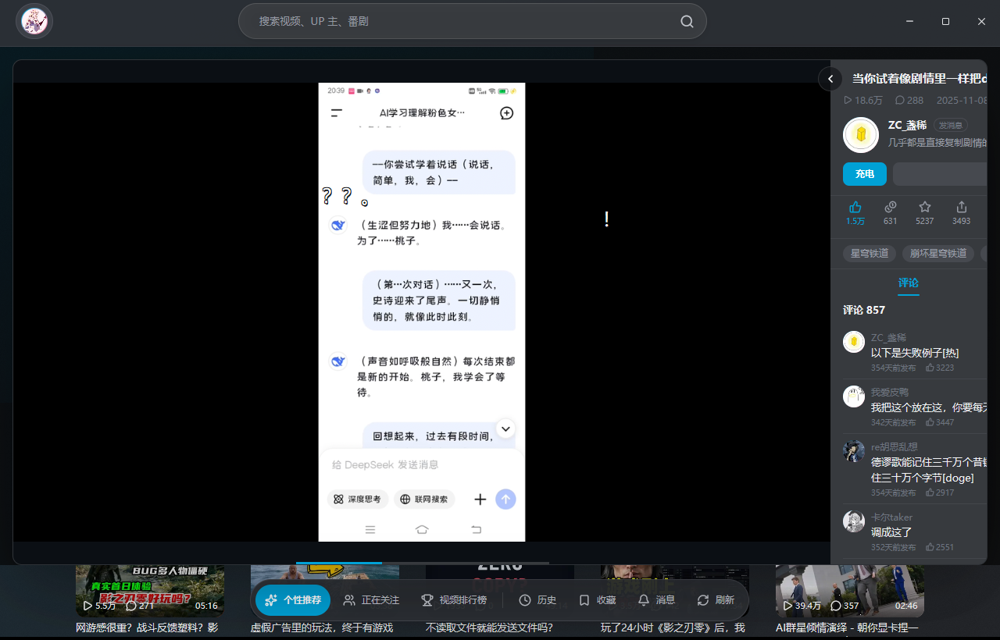

# Windows 移植记录

> 2026-10-30 · 目标：在不改变 macOS 行为的前提下，让 `yk-app` 在 Windows 上可构建、可播放、可打包。

## 1. 平台边界

移植的原则是**按文件分平台**，而不是在 macOS 代码里到处插 `cfg`：

| 模块 | macOS | Windows |
| --- | --- | --- |
| 视频线程 | `video_worker/macos.rs`：mpv → RGBA → NV12 → `CVPixelBuffer` | `video_worker/windows.rs`：mpv → BGRA → `RenderImage` |
| 画面合成 | GPUI `surface()`（Apple 专用） | GPUI `img(RenderSource)` + DirectX 图集 |
| 数据目录 | `~/Library/Application Support/YKPili` | `%APPDATA%\YKPili` |
| 缓存目录 | `~/Library/Caches/YKPili` | `%LOCALAPPDATA%\YKPili\Cache` |
| 窗口标题栏 | 透明标题栏 + 红黄绿 | 原生标题栏（DWM 深色） |
| 退出快捷键 | `⌘Q` | `Alt+Q` |
| 字体 | PingFang SC | Microsoft YaHei UI |

`video_worker/mod.rs` 只做平台分派，两个实现各自拥有独立的通道、命令与 EOF 判据，
公开接口保持一致（`spawn_with_audio` / `set_paused` / `seek` / `finished` / `latest`）。
macOS 的 `macos.rs` 内容是从原 `video_worker.rs` 原样搬过去的，没有改逻辑。

## 2. Windows 视频链路

```text
mpv (vo=libmpv, MPV_RENDER_API_TYPE_SW, SW_FORMAT=bgra, hwdec=auto-copy-safe)
  → render_frame_bgra()  （3.7 MB / 1280x720）
  → 独立线程：强制 alpha=255，经 mpsc 交给 UI
  → UI：current → image::RgbaImage::from_raw → RenderImage
  → GPUI img(ObjectFit::Contain) 贴到播放层
```
两个关键收尾：

1. **必须 `window.drop_image(旧图)`**：每帧 `RenderImage::new` 都会拿新 `ImageId`，
   DirectX 图集会为它分配纹理；不回收旧图，显存会随播放时间线性上涨。
   Windows 侧用 `current_image` / `current_image_serial` / `needs_image_clear` 三个字段管理。
2. **alpha 统一刷成 255**：mpv 的 `bgra` 第 4 字节不保证有值，GPUI 按预乘 alpha 混合，
   0 会让整帧透明。

性能（本机，release 构建，640x1280 竖屏片源、30fps）：

- `A-V: 0.000`，24 秒内 `Dropped: 3`；
- 进程工作集约 420 MB，连续播放内存平稳；
- debug 构建会明显掉帧（GPUI 全量重绘 + 3.7 MB 上传），验收请用 release。

## 3. 数据目录

新增 `yk-core/src/platform.rs`，session / settings / resume / 搜索历史 / 图片缓存全部
从这里取路径。macOS 的字符串保持原样，老用户的登录态与续播记录不会丢。

Windows：

- `%APPDATA%\YKPili\session.json`、`settings.json`、`resume.json`、`search_history.json`
- `%LOCALAPPDATA%\YKPili\Cache\`（推荐流 + 图片）
- 卸载不删除这两个目录。

## 4. 窗口与输入

- Windows 隐藏系统标题栏（`appears_transparent = true`），顶栏整条作为自定义标题栏：
  - 左侧头像（原品牌胶囊移除，头像从左/右两侧统一挪到左上角）；
  - 中间搜索框；
  - 右侧自绘最小化 / 最大化（还原）/ 关闭，关闭悬停为 Windows 红 `#C42B1C`。
- 拖动：Windows 后端没有实现 `start_window_move`，顶栏 `mouse_down` 走
  `ReleaseCapture()` + **PostMessage** `WM_NCLBUTTONDOWN / HTCAPTION`。
  必须用 PostMessage：SendMessage 会在事件处理函数里同步进入移动循环，
  GPUI 窗口过程被重入，App 的 RefCell 会 panic。
- 最大化 / 还原同样用 **PostMessage** `WM_SYSCOMMAND`（`SC_MAXIMIZE` / `SC_RESTORE`），
  避免同步 `ShowWindow` 让 GPUI 拿不到新视口（表现为最大化后只画左上角 1280x820）。
- 退出判定改用 `Alt+Q`：GPUI 在 Windows 上把 `modifiers.platform` 映射到 Win 键，
  Win+Q 会被系统搜索抢走；Ctrl+Q 又容易和输入框快捷键混淆。
  和 macOS 的 `⌘Q` 走同一套状态机：第一次只显示「再次按下 Alt+Q 键即可退出」，
  3 秒内再按一次才真正退出，按住不放的自动重复不算第二次。
  两端的提示文案都改成了「再次按下」，与真实行为一致。
- release 构建加 `windows_subsystem = "windows"`，不弹控制台；debug 构建保留控制台看日志。

## 5. 构建与打包

- 工具链固定为 Rust 1.99.1（`rust-toolchain.toml`）。原因：`gpui-fast` 0.1.10 用了
  `std::hint::cold_path`，1.94 的 stable 直接编译失败。
- 一键打包：`powershell -ExecutionPolicy Bypass -File scripts/package-windows.ps1`
- 产物：绿色目录、`YKPili-<版本>-windows-x64.zip`、`YKPili-<版本>-windows-x64-setup.exe`。
- **升级沿用旧目录**：安装器 `.onInit` 依次读注册表 `Software\YKPili\InstallDir`、
  卸载表 `InstallLocation`、常见目录，最后扫描固定磁盘的
  `X:\Program Files\YKPili` / `X:\Program Files (x86)\YKPili` / `X:\YKPili`；
  找到含 `ykpili.exe` 的目录就设为默认安装目录。命令行 `/D=...` 优先级最高。
- libmpv 按 `packaging/libmpv/features.toml` **裁剪编译**（`scripts/build-libmpv.sh`：
  FFmpeg `--disable-everything` 起步，只启用播放链路用到的解码器/解复用器/滤镜/
  wasapi + copy-back 硬解），不再塞 shinchiro 的 121 MB 全量包；随包附 GPL 文本、
  裁剪清单与源码说明。打包脚本默认自动执行裁剪，校验不过直接终止。
- **实测体积**：`libmpv-2.dll` 2.8 MB；FFmpeg 共享库 + libass/libplacebo 等运行时
  DLL 合计约 41 MB（其中 libplacebo 的 shaderc 依赖占 ~10 MB）。没装 MSYS2 时
  `scripts/install-msys2.ps1` 会自动下载解压并装依赖（`%LOCALAPPDATA%\ykpili\msys64`）。

## 6. 验收

release 构建实测（Windows 11 / DirectX 11）：

- 首页推荐、封面图、中文排版正常；
- 自绘标题栏：顶栏空白处可拖动窗口，右侧最小化 / 最大化 / 还原 / 关闭均实测通过，
  最大化后内容铺满 2560x1440，还原回到原 1280x820 位置；
- 关闭按钮悬停为 Windows 红，左上角头像点击可打开登录 / 账号面板；
- `Alt+Q` 第一次只显示「再次按下 Alt+Q 键即可退出」，3 秒内再按一次才退出，实测通过；
- `YK_BVID` 打开视频后首帧出现，弹幕、评论、互动面板都可用；
- 640x1280 竖屏片源 30fps 播放 24 秒：`A-V: 0.000`、`Dropped: 3`；
- 连续播放内存平稳（约 420 MB），换帧时旧 `RenderImage` 正确回收；
- 静默安装 / 卸载、桌面与开始菜单快捷方式、注册表项均实测通过；
- 绿色 zip 解压即用，`libmpv-2.dll` 与 exe 同目录。

截图：




## 7. 已知限制

- 4K / 高码率片源未做性能验证；当前固定 1280x720 渲染目标再放大。
- 没有代码签名，SmartScreen 会提示未知发布者。
- 全屏、画质切换、音量菜单等仍是 macOS 时期未接完的功能，Windows 一并继承。
- Intel / AMD 核显外的老显卡（D3D11 feature level < 11）未验证。
