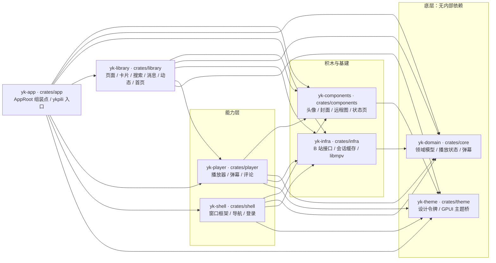
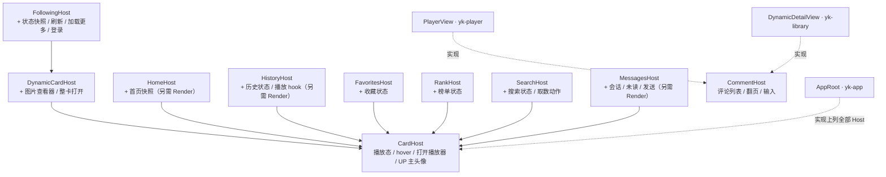
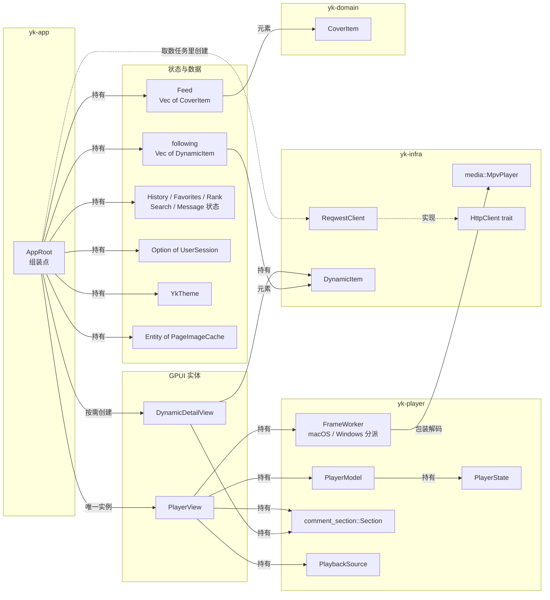

# 代码架构

> 八层结构已迁移完成，依赖只允许向下：`app → shell / library / player → components → theme`，
> `core`（包名 `yk-domain`）位于最底层，`infra` 负责外部世界（接口 / 存储 / 解码）。
> 文中的实线表示编译期依赖或持有，虚线表示 trait 实现 / 运行时回调。

## 目标 crate 结构

```text
crates/
├── core/            # 领域模型与纯逻辑，不依赖 gpui / 网络 / 存储
├── theme/           # 设计 token（颜色、间距、字体），无业务逻辑
├── components/      # 通用 UI 积木（按钮、卡片、进度条），无业务含义
├── shell/           # 窗口框架、导航栏、路由、全局布局
├── player/          # 播放能力：把 core::playback 映射到 GPUI Entity
├── library/         # 媒体库能力：把领域模型映射到列表 / 搜索 / 详情
├── infra/           # 网络、本地存储、解码；只和外部世界打交道
└── app/             # 唯一组装点：初始化 GPUI、创建实体、注入 infra
```

## Crate 依赖图

只画 8 个内部 crate 的编译期依赖（箭头＝「依赖」）；`gpui` / `gpui-kit` /
`gpui-pre` 是 UI crate 共同的外部底座，`reqwest` / `serde` / `image` / `objc2-*`
只出现在 `infra` 与 `player`，均省略。



两条**看起来跨层、实际有明确理由**的边：

- `shell → infra`：登录卡片与账号面板要用 `yk_infra::auth` 的二维码轮询、
  Cookie 解析和资料拉取，UI 只做状态机。
- `library → player`：动态详情复用 `yk_player::comment_section` 的评论区与
  `CoverSource` 的入场几何，避免两份评论 / 播放入口实现。

## 模块树

> `{a, b}.rs` 表示同目录下的多个文件；`mod.rs` 表示目录模块。

```text
app/crates/
├── core/                    # yk-domain：纯领域
│   └── src/{lib, models, api_models, playback, player, danmaku, format}.rs
├── theme/                   # yk-theme：设计令牌
│   ├── src/{lib, gpui_theme}.rs
│   └── src/theme/{mod, palette, surfaces, typography, dimensions, motion, shadows}.rs
├── components/              # yk-components：通用积木
│   └── src/{lib, avatar, cover, media, gallery, status}.rs
├── shell/                   # yk-shell：窗口与全局导航
│   └── src/{lib, root, frame, top_bar, dock, route, overlay, account_view, login_view}.rs
├── player/                  # yk-player：播放能力
│   ├── src/lib.rs           # PlayerView（全进程唯一实例）
│   ├── src/controller.rs    # 取流 / 播放控制 / 互动动作
│   ├── src/model.rs         # PlayerModel（PlayerState + 控制栏状态）
│   ├── src/video.rs
│   ├── src/comment_section.rs   # 评论区通用实现 + CommentHost
│   ├── src/comment_view.rs      # 评论行 / 文本复制菜单
│   ├── src/view/{mod, playback, controls, panel, tabs, actions, danmaku}.rs
│   └── src/video_worker/{mod, macos, windows}.rs
├── library/                 # yk-library：浏览能力
│   ├── src/lib.rs
│   ├── src/card.rs          # 视频封面卡 + CardHost
│   ├── src/cover.rs         # 封面渐变 / 播放量 / 时长
│   ├── src/image.rs         # 图片驻留计数
│   ├── src/page_image_cache.rs
│   ├── src/home.rs          # 首页网格 + HomeHost
│   ├── src/pages.rs         # 热门 / 分区 / 直播等四态页
│   ├── src/rank.rs
│   ├── src/favorites.rs
│   ├── src/history.rs
│   ├── src/up_profile.rs    # UP 主空间浮窗
│   ├── src/settings_view.rs
│   ├── src/search.rs        # 搜索状态 + SearchHost
│   ├── src/search_ui.rs     # 搜索页渲染
│   ├── src/messages.rs      # 消息状态 + MessagesHost
│   ├── src/messages_ui.rs   # 消息中心 / 私信渲染
│   ├── src/dynamic_card.rs  # 动态卡 + DynamicCardHost
│   ├── src/dynamic_view.rs  # 动态详情浮层
│   ├── src/following.rs     # 关注流瀑布流 + FollowingHost
│   └── src/image_viewer.rs
├── infra/                   # yk-infra：外部世界
│   ├── src/lib.rs
│   ├── src/api/{mod, client, bilibili, wbi, limits}.rs   # 接口 / 签名 / 限流
│   ├── src/media/{mod, convert, pixel_buffer}.rs         # libmpv / NV12 / IOSurface
│   ├── src/{auth, login, session, device}.rs             # 登录与会话
│   ├── src/{feed, feed_cache, search, dynamic, favorites, history, ranking, messages, interaction, space, resume}.rs
│   └── src/{cache, settings, platform, image_cache, http, win_clipboard}.rs
└── app/                     # yk-app：组装点
    ├── src/{lib, main}.rs   # AppRoot / ykpili 入口
    ├── src/mock.rs          # 离线占位推荐数据
    ├── src/history_actions.rs   # HistoryHost 适配
    └── src/dynamic_view.rs      # 兼容 shim → yk_library::dynamic_view
```

## 关键类型关系

### 宿主 trait 层次

视图 crate 不反向依赖 `app`：所有交互都收敛到一组 `Host` trait，由 `AppRoot`
（以及两个视图实体）实现。箭头表示「继承父 trait」。



`AppRoot` 是这些 trait 的唯一实现者（`PlayerView` / `DynamicDetailView` 只实现
`CommentHost`），页面代码只认 trait，不认 `AppRoot`。

### 运行时对象持有



数据流一句话：`ReqwestClient` 调 `yk_infra::api::client::fetch_*` 拿到领域模型
（`CoverItem` / `UserSession` / `DynamicItem` …），写进 `Feed` 或各页面状态，
`library` 视图从状态画出元素，`AppRoot` 只负责创建实体、注入 cookie 与路由。

### 关键类型速查

| 类型 | 定义处 | 角色 |
| --- | --- | --- |
| `AppRoot` | `app/src/lib.rs` | 唯一组装点；持有全部状态、`PlayerView` 与详情实体 |
| `PlayerView` | `player/src/lib.rs` | 播放器实体，全进程唯一；持有模型 / worker / 评论区 |
| `DynamicDetailView` | `library/src/dynamic_view.rs` | 动态详情浮层实体，按需创建 |
| `PlayerModel` | `player/src/model.rs` | 播放器界面状态（控制栏 / 错误 / 音量） |
| `PlayerState` | `core/src/player.rs` | 与 UI 无关的播放状态（进度 / 倍速 / 音量） |
| `Feed` | `infra/src/feed.rs` | 首页卡片池，元素是 `CoverItem` |
| `FrameWorker` | `player/src/video_worker/` | 平台解码线程；内部包 `MpvPlayer` |
| `HttpClient` | `infra/src/api/bilibili.rs` | 请求抽象；生产实现只有 `ReqwestClient`，其余是测试替身 |
| `MpvPlayer` | `infra/src/media/mod.rs` | libmpv FFI 封装（软件渲染 → RGBA / NV12） |

> 注：`HttpClient` trait 目前在 `infra` 内部，而不是 `core`。请求签名依赖
> `ReqwestClient` 的 cookie / 设备指纹等实现细节，下沉到 `core` 反而要搬一堆
> 类型；如果以后要换 HTTP 栈，这里是最先要动的边界。

## 三条归属标准

一段逻辑该放哪，只看它「离开当前 UI 框架还成不成立」：

1. **换一个 UI 框架仍然成立** → `core`。
   例如播放队列、续播规则、码率选择、进度合并、权限判定。
2. **只在 GPUI 的渲染 / 事件循环里有意义**（焦点、hover、布局测量、动画时序）
   → 能力 crate 的 `view` / `model`。例如控制栏 5 秒自动隐藏、
   封面到播放器的入场几何、虚拟列表的可视行计算。
3. **只负责和外部世界打交道**（HTTP、文件、DRM SDK、解码库）
   → `infra`。例如 B 站接口客户端、本地 session / 缓存、libmpv 绑定。

判定顺序：先问「换框架还成立吗」，再问「是不是只在跟外部系统交互」，
最后剩下的才是 GPUI 适配层。

## 唯一性约束

- 同一个视觉组件全应用只有一份实现。`components` 是唯一的通用积木来源，
  `shell` / `library` / `player` 只组合、不复制。
- 同一个行为只有一个入口。例如播放 / 暂停只有 `PlayerView::toggle_play`，
  seek 只有 `PlayerView::seek`，视图与控制条都调它。
- 迁移时先搬实现、再改引用；不允许为了目录形状重写一份并行实现。

## 当前进度

| crate | 状态 | 说明 |
| --- | --- | --- |
| `theme` | ✅ | 从 `yk-ui` 拆出，`YkTheme` + `gpui_theme` 桥接 |
| `components` | ✅ | 三态 / 四态、`avatar`（统一头像）、`media`（统一远程图）、`cover::placeholder_gradient`、组件验收页 |
| `player` | ✅ | 已独立 crate，内部按 `lib / model / controller / view` 分层 |
| `library` | ✅ | 已迁入 `pages`、封面视觉、卡片、UP 主空间、收藏夹、排行榜、观看历史、搜索 / 消息页面渲染（`search_ui` / `messages_ui`）、动态卡片整卡（`dynamic_card`）、动态详情（`dynamic_view`）、关注流（`following`）与首页网格（`home`） |
| `shell` | ✅ | Dock、顶栏 chrome、背景、`ShellFrame` 根布局、通知层、`Route`、登录 / 账号均已迁入 |
| `core` | ✅ | `crates/core`（`yk-domain`）：format / models / api_models / playback / PlayerState / danmaku，全部无 UI / 无网络 |
| `infra` | ✅ | `crates/infra`：B 站接口客户端、auth / session / cache / feed / 收藏 / 历史 / 消息取数、平台路径、GPUI HTTP 客户端、Windows 剪贴板、libmpv 媒体引擎（media）；无 UI 依赖 |
| `app` | ✅ | `crates/app`（包名 `yk-app`）：唯一组装点——`AppRoot` 状态与动作、页面槽位、实体注入、Dock 入口表与顶栏头像；各 `Host` 适配只做转发 |

> 结构迁移已完成（过程见文末《迁移收尾记录》）；下一批工作是重复实现清理，
> 见《[重复实现清理计划](#重复实现清理计划2026-11-04-审计)》。

## 播放后端说明

`player` 的控制层按「封装一个 `VideoPlayer` 实体」组织，但当前后端仍是
自研的 libmpv + `video_worker` 链路。`alhazen-gpui` 0.7.1 依赖 crates.io 的
`gpui 0.2.2`，与本项目的 `gpui-kit 0.8.0` / `gpui-pre 0.3.9` 不是同一个 crate，
不能直接替换；接入前需要先解决 GPUI 底座兼容问题。

## 常用校验

```bash
cd app
cargo check --workspace --all-targets
cargo test -p yk-player
cargo test -p yk-app --test player_hover
```

## 迁移收尾记录（2026-11-03 完成）

当前状态：8 个 crate 已成型，`theme / components / core / infra / player / shell` 完成，
`library` 覆盖页面、收藏、排行、历史、搜索、消息渲染、动态（卡片 / 详情 / 关注流）
与首页网格；`app` 只剩组装点与界面装配，八层结构迁移到此收口。

下面的 1–5 按完成顺序记录；新增工作请另起一节，不要回写历史结论。

### 1. 动态卡片渲染 ✅ 2026-11-03

整卡与占位卡已迁入 `library::dynamic_card`：

- `DynamicCardHost` 增补 `dynamic_open_card(item, origin, window, cx)`：
  视频 / 详情由宿主分流，播放器或详情已开时由宿主丢弃点击；
- `card` / `card_ghost` 与 `quote_block` / `link_block` / `card_action` 一并迁入；
- `CardOrigin` 落在 library，app 侧 `dynamic_view` 只做 `pub use`；
- 头部拆成 `author_avatar` + `header_row`，占位卡不再需要宿主类型；
- `image_grid` / `video_block` 继续由整卡与详情共用同一份实现。

验证：`cargo check --workspace --all-targets` 通过；
`cargo test -p yk-library -p yk-app` 全绿（含 `dynamic_detail_copy` /
`following_card_copy`）。

### 2. 动态详情实体 ✅ 2026-11-03

- `DynamicDetailView`（约 1630 行）整文件迁入 `library::dynamic_view`，跨层引用改为
  `yk_player::comment_section` / `yk_player::comment_view`、`crate::cover`、
  `yk_infra::http`；
- `begin_close` 由 `pub(crate)` 提为 `pub`：宿主的验收钩子与外部关闭需要它；
- app 侧 `dynamic_view` 只留 `pub use yk_library::dynamic_view::*;`；
  实体创建、关闭回调、图片查看器接线仍在 `AppRoot`（组装点）；
- 测试入口（`dynamic_detail_copy` / `dynamic_comment_select`）路径与断言不变。

验证：`cargo check --workspace --all-targets` 通过；`cargo test --workspace` 全绿。

### 3. 关注流 ✅ 2026-11-03

- `FollowingHost`（`FeedState` 快照 + `following_refresh` / `following_load_more` /
  `following_sign_in`）定义在 `library::following`，网络与分页实现仍在组装点；
- 页面、骨架、空 / 错误 / 登录引导与瀑布流（列分配、可视区判定）整段迁入
  `library::following::page`，卡片直接复用 `dynamic_card::card`；
- `app/src/dynamic_feed.rs` 删除，剩余 `debug_text_item` 与
  `open_dynamic_video` / `open_dynamic_detail` 并入 `app/src/lib.rs`（组装点）。

验证：`cargo check --workspace --all-targets` 通过；`cargo test --workspace` 全绿
（`following_card_copy` 覆盖卡片点击与复制边界）。

### 4. app 收尾 ✅ 2026-11-03

- [x] 首页网格 / 首屏骨架 / 列数几何迁入 `library::home`
      （`HomeHost` + `HomeState`，`v_virtual_list` 与图片预热一起下沉），
      补页计算改用 `home::min_items`，网格单测随迁；
- [x] 占位推荐数据移到 `app/src/mock.rs`（离线兜底与视觉验收用）；
- [x] 删除 app 内联的 `messages_view` / `search_view` 兼容 re-export 模块
      （引用改为 `yk_library::search` / `search_ui` / `messages` / `messages_ui`）；
- [x] `app/src/history_actions.rs` 只保留 `HistoryHost` 访问器与播放器 hook（62 行）。

留在 `app/src/lib.rs` 的是组装点职责：`content_area` 页面槽位、`AppRoot` 动作与
实体注入、Dock 入口表（`DockEntry` 依赖 `Route`）与顶栏头像（依赖登录状态），
按三条归属标准都属于「只在 GPUI 外壳里成立」的装配层。

### 5. 可选清理（2026-11-03 复核）

- [x] 包名 / 目录命名已核对，**结论是不改**：实际约定是「目录短名 + 包名 `yk-*`」，
      8 个 crate 里 7 个符合（`app/` ↔ `yk-app`、`theme/` ↔ `yk-theme` …）；
      唯一例外是 `core/` ↔ `yk-domain`（历史命名），改名要动全部 `yk_domain::`
      引用（47 处）与文档，收益只是名字整齐，风险不划算。
- [x] `player/src/view/mod.rs` 拆出 `view/playback.rs`：`ensure_worker`（首帧准备）
      与 `ensure_playback_loop`（播放循环）各自成方法，`render` 里只剩两次
      按帧检查和一行注释；`mod.rs` 938 → 803 行。
- [x] 删除迁移后残留的空壳目录 `app/crates/yk-{app,core,media,ui}`（不在 workspace，
      只有 `.DS_Store` 与构建缓存）；`yk-media` 里唯一有用的
      `src/bin/frame_probe.rs` 迁到 `app/crates/infra/examples/frame_probe.rs`：
      `cargo run -p yk-infra --example frame_probe -- <video> <out.png>`。

### 验证基线

```bash
cd app
cargo check --workspace --all-targets
cargo test --workspace
# 视觉截图默认 skipped，需要显式开启
YK_VISUAL=1 cargo test -p yk-app --test messages_visual --test search_visual --test pages_visual
```

## 重复实现清理计划（2026-11-04 审计）

> 结构迁移（上面 1–5 节）已完成；本节是审计出的下一批任务，完成后直接在本节勾选，
> 不回写历史结论。扫描口径：`app/crates` 122 个 `.rs` / 58,814 行 / 1,157 个函数，
> 去注释、保留字面量的归一化指纹 + 5-token 相似度；结论是「业务解析层干净，
> 重复集中在视图四态、图片 URL 规则与 AppRoot 装配流程」。

### 总览

| 优先级 | 主题 | 重复点 | 预估 |
| --- | --- | --- | --- |
| P0 | 图片 URL / 缩略图规则 | 8+ 处、3 种语义 | 0.5 天 |
| P0 | 错误 / 空 / 重试 / 骨架四态 | 19 个自建函数 vs 11 次复用 | 1 天 |
| P1 | 数据工具（JSON / 路径 / 落盘 / 插值） | 4 + 4 + 5 + 4 份 | 0.5 天 |
| P1 | 装配流程（刷新 / 关注 / 关闭 / 登录 / 分页） | 5 组 | 1 天 |
| P2 | 小组件与测试样板 | 8 组 | 0.5 天 |

### P0 · 图片 URL 与缩略图

- [ ] 统一到 `infra` 新建的 `media_url` 模块（`upgrade_scheme` / `thumb` / `original`），
      替换以下 8 处：
      `history.rs:224`、`messages.rs:920`（两份 `thumb_url`）、
      `favorites.rs:196`、`ranking.rs:284`（两份 `thumb`）、
      `search.rs:859`（`image_url`）、`dynamic.rs:146`（`original_url`）、
      `dynamic.rs:130`（`asset_url`）、`messages_ui.rs:548`（UI 层 `face_thumb`）。
- [ ] 统一行为：`http://` 的升级范围（是否限 `hdslb.com`）、已有 `@` 后缀是否跳过、
      非图床域名是否原样返回；三处规则目前不一致。
- [ ] 顺手修掉 UI 层风险：`messages_ui::face_thumb` 不检查已有 `@` 后缀、
      不升级 `http://`，可能拼出双后缀 / 明文 http 头像。
- [ ] 5 个 `face_thumb_url()`（`history.rs:93`、`favorites.rs:54`、`ranking.rs:150`、
      `messages.rs:169/550`）改为调用统一 helper。
- 验收：`media_url` 新增单测覆盖「协议相对 / http / 已有后缀 / 非图床」四类输入；
      `cargo test -p yk-infra`；`YK_VISUAL=1` 抽查头像与封面不回归。

### P0 · 状态四态

- [ ] 扩展 `components::status`：`empty` / `error` 支持自定义图标、标题、描述与动作
      （重试 / CTA），让页面只传文案与回调。
- [ ] 迁移 6 份错误态：`messages_ui.rs:334`、`search_ui.rs:2034`、`history.rs:1114`、
      `following.rs:257`、`rank.rs:626`、`favorites.rs:921`。
- [ ] 迁移 3 份空态：`messages_ui.rs:387`、`history.rs:1179`、`search_ui.rs:2086`。
- [ ] 重试按钮收敛：`rank.rs:645`、`favorites.rs:898`、`dynamic_view.rs:151`
      与 4 处内联（文案共 13 处），统一尺寸 / 颜色 / hover。
- [ ] 骨架屏收敛：把 10 个构建器里的脉冲与相位逻辑抽成
      `status::skeleton_rows(theme, rows, row_h, phase_step)`；
      各页不同的行几何保留，避免为了统一牺牲布局。
- 验收：`cargo test --workspace`；`YK_VISUAL=1` 出图对比收藏 / 排行 / 消息 / 搜索 / 关注。

### P1 · 数据工具

- [ ] `lerp_bounds` ×4 合并到 `theme::motion`：
      `shell/account_view.rs:483`、`library/dynamic_view.rs:1426`、
      `library/up_profile.rs:1798`、`player/controller.rs:2159`。
- [ ] `str_of` / `num` 各 4 份合并到 `infra::api::json`，先统一语义
      （trim、非字符串数字、浮点兜底）：
      `space.rs:842/851`、`favorites.rs:203/212`、`search.rs:893/904`、`ranking.rs:291/300`。
- [ ] 配置路径 `default_path` 4 份 + JSON 落盘 5 份合并到 `platform`：
      `resume.rs:68/99`、`search.rs:944/1021`、`settings.rs:46/70`、
      `session.rs:85/96`、`device.rs:54/72`。
- [ ] `to_cover_item` ×3（`favorites.rs:59`、`ranking.rs:166`、`search.rs:166`）
      抽共享构造，占位色取模只留一份。
- 验收：`cargo test -p yk-infra -p yk-domain`；合并前先用现有单测锁定语义。

### P1 · 装配流程

- [ ] `refresh_feed_anonymous` / `_authenticated`（`app/src/lib.rs:1088/1172`）
      合成一个带 cookie 与日志上下文的函数（两版 97% 相同）。
- [ ] `toggle_follow`（`player/controller.rs:400`、`library/up_profile.rs:547`）
      抽共享流程：乐观更新、粉丝数 ±1、失败回滚、未知状态先查后写。
- [ ] `begin_close`（`library/dynamic_view.rs:206`、`library/up_profile.rs:521`）
      抽退场动画 helper；顺手把 `close_handler` 的 `bool` 参数统一掉。
- [ ] 登录两个提交（`shell/login_view.rs:225/291`）合成 `submit_with(fetch, empty_hint)`。
- [ ] 分页状态机：`feed` 与 `following`（`app/src/lib.rs:1247/1397/1489/1666`）
      抽 `PagedFeed<T>`（页 / offset、generation、has_more、loading×2）。
- [ ] 删除死代码：`library/dynamic_view.rs:1627 current_session`
      （编译器已报未使用，且与 player 两份重复）。
- 验收：`cargo test --workspace`；手动回归关注 / 取关、连续刷新、关浮层。

### P2 · 小项与测试

- [ ] 卡片动画三件套（`library/card.rs:305/330/355`）合成一个带 id 前缀 / 时长 /
      变换函数的 helper。
- [ ] `notice` ×2（`messages_ui.rs:600`、`search_ui.rs:2144`）合并到
      `status::toast_bar`；`dynamic_view.rs:1611` 的变体复用同一实现。
- [ ] 请求管道：`client.rs` 的 `get` / `get_bytes` / `post_form` /
      `post_form_with_referer` / `post_json` 抽公共头 / 限流 / 状态码处理。
- [ ] 小重复：`image_viewer` 的 `open` / `open_without_focus`（147/169）、
      `comment_section` 的 `bump_toggle` / `bump_lift`（570/589）、
      `media` 的 `get_property_flag` / `get_property_double`（460/484）、
      `messages` 的 `message_time` / `chat_time_label`（728/752）、
      `dynamic_view` 与 `image_viewer` 的复制图片流程。
- [ ] 测试：8 份 `capture` 抽到 `app/tests/common/mod.rs`
      （`search_visual.rs:38` 等 8 个文件，其中 3 份逐字相同）。
- 验收：`cargo test --workspace`；不引入新依赖。

### 明确不动的「合理重复」

| 项 | 理由 |
| --- | --- |
| `infra::search` / `library::search` 等同名模块 | 数据层 / 视图层分工，不是重复 |
| `macos.rs` / `windows.rs` 的 `spawn_with_audio`、`latest` | 平台 ABI 分支；建议只抽线程骨架，防两端口径漂移 |
| `theme` 的 light / dark 表 | 数据平行；改数据驱动收益低于风险 |
| `components::cover` 与 `library::cover` | 渐变底座 / 组合封面，上下层复用 |
| 三套缓存（包 / 磁盘图 / 页面驻留） | 职责不同 |
| `messages_ui::avatar`、`app::avatar` | 都是 `components::Avatar` 的薄封装 |

### 审计结论

- 规模：122 个 `.rs` / 58,814 行 / 1,157 个函数；
- 指纹：6 组完全同构、122 组结构相似，逐条复核后约 20 组值得处理；
- 业务解析（弹幕 / 评论 / 收藏 / 排行 / WBI / Cookie / HTTP）均为单点实现，
  重复集中在视图四态、URL 规则与 AppRoot 装配流程；
- 总预估 2.5–3 天；先完成两个 P0（约 1.5 天）即可消掉视觉不一致与 URL 行为漂移。
